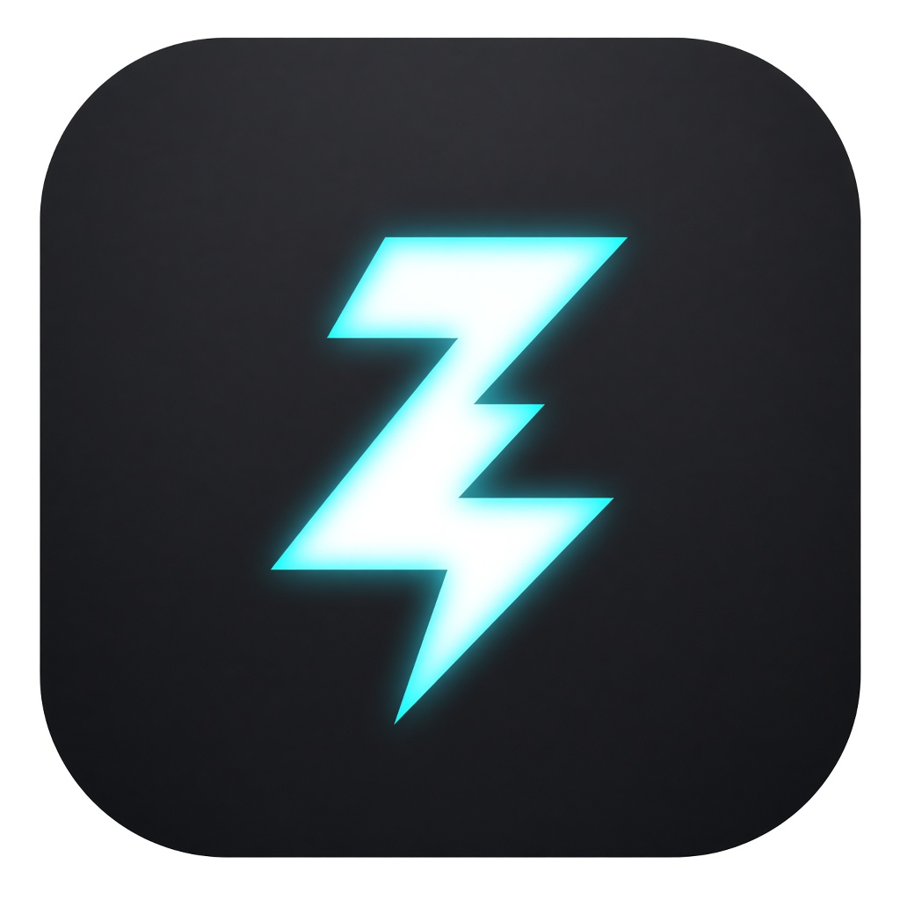

# Blitz

<p align="center">
  
</p>

**Open-source macOS launcher + Clipy-class clipboard** — Swift / AppKit, no paid Apple Developer ID required.

Think Raycast-shaped daily driver: one HUD for apps, files, calc, snippets, quicklinks, local extensions, **and** a deep clipboard (types, OCR, pin, Clipy-style menus). Sync catalogs over **iCloud Drive** without CloudKit.

| | |
|---|---|
| Version | **0.5.0** |
| App | `~/Applications/Blitz.app` |
| Bundle ID | `research.reversedir.blitz` |
| URL scheme | `blitz://` |
| Signing | **Blitz Dev** (local self-signed) |
| Data | `~/Library/Application Support/Blitz/` |
| Log | `~/Library/Logs/Blitz.log` |
| Requirements | macOS 14+, Apple Silicon |
| License | [MIT](./LICENSE) |
| Repo | [godlockin/Blitz](https://github.com/godlockin/Blitz) (`miao`) |

> Clean-room rewrite. No Raycast binaries, assets, or proprietary code.

---

## Quick start

```bash
make signing-cert   # once — stable local identity (Accessibility survives rebuilds)
make install        # → ~/Applications/Blitz.app
make doctor         # toolchain + codesign identity check
```

Optional: `make signing-allow-codesign` once if codesign keeps asking for a keychain password.

**First launch:** grant **Accessibility** (paste / window snap). macOS may also prompt for **Automation** (System Events).

Day-to-day use `make install` (Blitz Dev). GitHub Release zips are **ad-hoc** signed — fine to try, worse for stable TCC.

---

## Features

### Launcher

| Need | Behavior |
|---|---|
| Apps / files | Prefix-ranked search; open from the HUD |
| Calculator | Type an expression → copy result |
| Snippets | Folders, keywords, import/export; hotkey **⇧⌘B** |
| Quicklinks / scripts | Searchable; `{Query}` substitution in Settings |
| Window snap | `left` / `right` / `center` / `max` … |
| Extensions | Local `extension.json` packages ([docs](./docs/EXTENSIONS.md)) |

### Clipboard (Clipy+)

| Need | Behavior |
|---|---|
| Rich history | Text, images, RTF/HTML/PDF/files/URLs/colors |
| OCR | On-device text from images |
| Pin | **⌘P** in panel, or **⌃**+select in menus |
| Clipy-parity | Exclude apps, conceal/Universal ignore, type toggles, clear policies, screenshot ingest, menu modifiers |
| Menus | Main menu **⌥⌘V**; history **⌃⌘V** / menu-bar click |

### Sync & polish

| Need | Behavior |
|---|---|
| iCloud Drive | Optional sync of snippets / quicklinks / scripts (+ text-clip index) → `CloudDocs/Blitz/` |
| UI | Vibrancy HUD, inset rows, open/close motion, selection tint |

**Not in scope (yet):** Raycast-style extension *store*, Paste-class full media sync, CloudKit container, AI / MCP, notarized public DMG.

Positioning vs Maccy / Clipy / Paste / Raycast / Alfred → [docs/COMPARISON.md](./docs/COMPARISON.md).

---

## Hotkeys (defaults)

| Action | Shortcut |
|---|---|
| Launcher | **⌃⌥Space** |
| Clipboard panel | **⌃⌥V** |
| Main menu (at mouse) | **⌥⌘V** |
| History menu | **⌃⌘V** / menu-bar left click |
| Snippets | **⇧⌘B** |
| Settings | **⌃⌥⇧⌘V** |

---

## Extensions

Drop packages under:

```text
~/Library/Application Support/Blitz/Extensions/<id>/extension.json
```

Commands appear in launcher search. Modes: `run` (shell) · `open` (URL / path). Reload from launcher (**Reload Extensions**) or restart.

Settings → **Open Extensions Folder**. Full manifest: [docs/EXTENSIONS.md](./docs/EXTENSIONS.md).

---

## iCloud sync

Settings → enable **Sync catalogs via iCloud Drive** (optional: text clipboard index).

Writes to:

```text
~/Library/Mobile Documents/com~apple~CloudDocs/Blitz/
```

Works with a free Apple ID — **no** paid CloudKit container. Syncs catalogs, not full image/media history (unlike Paste).

---

## Architecture

```text
Swift AppKit agent
  ├── NSVisualEffect HUD (launcher / clipboard)
  ├── HotKeyManager · PasteHelper · Accessibility
  ├── ClipboardStore · SnippetStore · ExtensionStore · SearchService
  ├── iCloudSyncService → CloudDocs/Blitz/
  └── SQLite + Extensions/ under Application Support/Blitz/
```

Acceptance fixtures: `Reconstruction/` · Contribute: [CONTRIBUTING.md](./CONTRIBUTING.md).

---

## Make targets

| Target | Purpose |
|---|---|
| `make signing-cert` | Create **Blitz Dev** identity (once) |
| `make install` | Build, sign, install to `~/Applications` |
| `make app` | Build + sign into `dist/Blitz.app` |
| `make doctor` | Check `swiftc` + codesign identity |
| `make signing-allow-codesign` | Reduce keychain password prompts |
| `make dist-ci` | Ad-hoc zip for CI / GitHub Release |
| `make clean` | Remove build artifacts |

---

## Releases

```bash
git tag v0.5.0 && git push origin v0.5.0
```

Workflow: [`.github/workflows/release.yml`](./.github/workflows/release.yml) → ad-hoc `Blitz-macos-arm64.zip`.

**Why install isn’t one-click like Clipy:** Clipy ships with **Developer ID + notarization**. Blitz stays self-signed while unpaid — Gatekeeper will warn; that’s expected, not a bug. Details in [COMPARISON.md](./docs/COMPARISON.md).

---

## License

[MIT](./LICENSE)
